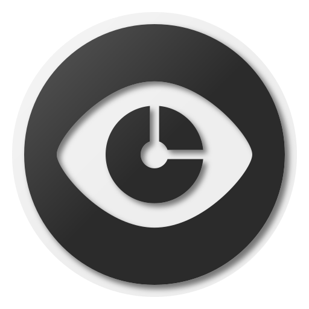
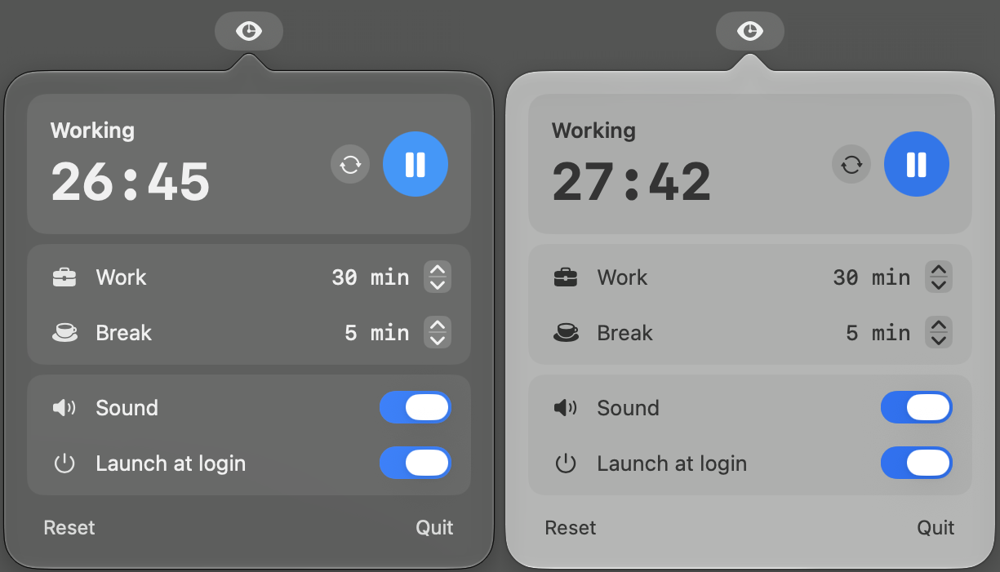
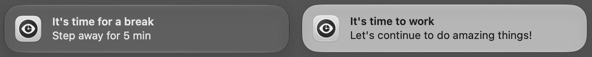

# SaveMyEyes

<p align="center">
  
</p>

<h3 align="center">A lightweight macOS menu bar utility that reminds you to take regular breaks and protect your vision.</h3>

<p align="center">
  <a href="https://github.com/masich/SaveMyEyes/releases"></a>
  <a href="https://swift.org"></a>
  <a href="LICENSE"></a>
  <a href="https://www.codefactor.io/repository/github/masich/savemyeyes"></a>
</p>

---

## Overview

Staring at screens for extended hours without breaks causes digital eye strain, fatigue, and headaches. **SaveMyEyes** lives unobtrusively in your macOS menu bar to help you maintain healthy computer habits and follow rest techniques (like the 20-20-20 rule or Pomodoro interval pacing).

Configure your preferred work and break durations, and SaveMyEyes will handle the rest—intelligently pausing when you are away from your Mac, alerting you when it is time to relax, and keeping distractions to a minimum.

---

## ✨ Features

- **⏱️ Flexible Intervals**: Choose custom work intervals (1 to 180 min) and break intervals (1 to 180 min) tailored to your workflow.
- **💤 Smart Activity & Sleep Detection**: Automatically pauses when you are idle or when your Mac goes to sleep, recovering seamlessly upon your return.
- **🔔 Actionable Notifications**: Receive macOS system alerts when a break or work session ends, complete with quick actions to **Snooze (5 min)**, **Skip**, or **Pause**.
- **🖱️ Menu Bar & Context Menu**: Minimalist popover with real-time countdown, quick-toggle buttons, and a right-click status bar menu (`Pause / Resume`, `Switch Mode`, `Preferences`, `Quit`).
- **🔊 Audio Cues**: Optional gentle sound alerts at interval completion.
- **🚀 Native Launch at Login**: Seamless macOS Service Management (`SMAppService`) integration to run on system startup without helper overhead.
- **🌍 Multi-Language Support**: Fully localized in 8 languages:
  - English
  - German (Deutsch)
  - Spanish (Español)
  - French (Français)
  - Italian (Italiano)
  - Polish (Polski)
  - Romanian (Română)
  - Ukrainian (Українська)
- **🔒 Privacy First**: 100% offline. No analytics, no telemetry, no network calls, and no background tracking.
- **⚡ Native Performance**: Pure SwiftUI and AppKit architecture designed for macOS Sonoma and Sequoia with near-zero CPU and memory overhead.

---

## 🖥️ Requirements

- **macOS 14.0 (Sonoma)** or later (including macOS 15 Sequoia)
- Apple Silicon (M1/M2/M3/M4) or Intel processor

---

## 📦 Installation

### Using Homebrew

```bash
brew tap masich/brew
brew install --cask savemyeyes
```

### Manual Download (`.dmg`)

1. Download the latest `.dmg` release from [GitHub Releases](https://github.com/masich/SaveMyEyes/releases).
2. Open the disk image and drag **SaveMyEyes** to your `Applications` folder.
3. Launch the application.

> [!NOTE]
> If macOS displays an unverified developer prompt:
> - **Control-click (or right-click)** `SaveMyEyes.app` in Finder and select **Open**, or
> - Open **System Settings > Privacy & Security** and click **Open Anyway** under the *Security* section.

---

## 📸 Screenshots

### Menu Bar Popover


### Notifications


---

## 🛠️ Building from Source

### Prerequisites
- macOS 14.0+
- Xcode 15.0 or later

### Build & Run
```bash
# Clone repository
git clone https://github.com/masich/SaveMyEyes.git
cd SaveMyEyes

# Run unit test suite
xcodebuild test -project SaveMyEyes.xcodeproj -scheme SaveMyEyes -destination 'platform=macOS'

# Build release binary
xcodebuild -project SaveMyEyes.xcodeproj -scheme SaveMyEyes -configuration Release build
```

Alternatively, open `SaveMyEyes.xcodeproj` in Xcode and press `Cmd + R` to run or `Cmd + U` to execute tests.

---

## 🤝 Contributing

Contributions, issues, and feature suggestions are welcome!
Feel free to open an issue or submit a pull request on [GitHub](https://github.com/masich/SaveMyEyes).

---

## 📄 License

This project is licensed under the Apache 2.0 License - see the [LICENSE](LICENSE) file for details.
